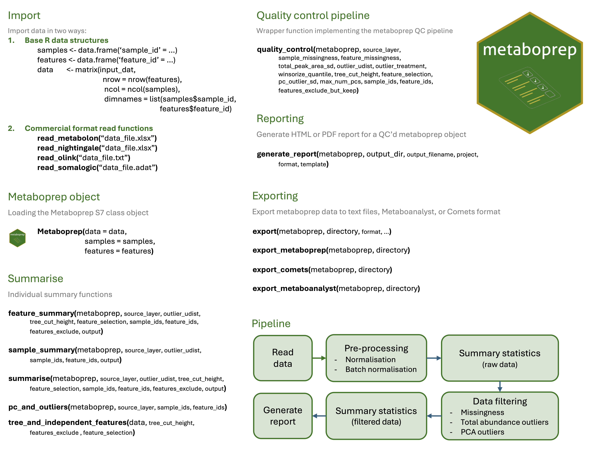
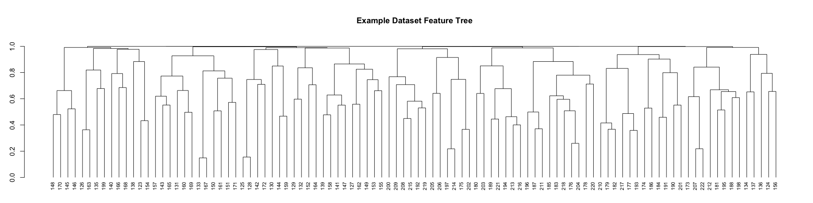

<!-- README.md is generated from README.Rmd. Please edit that file -->

# metaboprep

<!-- badges: start -->
[](https://lifecycle.r-lib.org/articles/stages.html#superseded)
[](https://www.repostatus.org/#unsupported)
[](https://github.com/MRCIEU/omiprep)
[](#known-issue-principal-variable-selection)
[](https://doi.org/10.1093/bioinformatics/btac059)
[](LICENSE)
<!-- badges: end -->

> [!IMPORTANT]
> **metaboprep is no longer maintained. Please use [omiprep](https://github.com/MRCIEU/omiprep).**
>
> omiprep is the successor to metaboprep for metabolomics and proteomics data. It was first released as metaboprep v2 and has since been renamed.
>
> - Code: <https://github.com/MRCIEU/omiprep>
> - Software archive: [10.5281/zenodo.20941283](https://doi.org/10.5281/zenodo.20941283)
> - Manuscript (bioRxiv preprint, under revision; posted as metaboprep v2): [10.1101/2025.11.11.687831](https://www.biorxiv.org/content/10.1101/2025.11.11.687831v1)
>
> ```r
> # install.packages("pak")
> pak::pak("MRCIEU/omiprep")
> ```
>
> This repository remains available so that published analyses can be reproduced. No further fixes or features will be added.

## Known issue: principal variable selection

metaboprep identifies a set of approximately independent features, or *principal variables*, by clustering features on a dendrogram (distance = 1 − |Spearman's ρ|), cutting the tree at `tree_cut_height`, and keeping one feature from each cluster. The intended rule, as described in [Hughes et al. 2022](https://doi.org/10.1093/bioinformatics/btac059), was to keep the feature with the **least** missingness in each cluster.

The pipeline code instead kept the feature with the **most** missingness. It counted the non-missing values per feature and then selected the feature with the smallest count.

**Who is affected**

| Version | Selection rule | Affected? |
|---|---|---|
| From the first release (2020) to July 2025, including v1.0 | Least missingness (the only option) | **Yes**, in the main QC pipeline |
| Current `master` (v1.0.1 and later), default `feature_selection = "max_var_exp"` | Feature with the highest summed correlation to the rest of its cluster | No |
| Current `master` with `feature_selection = "least_missingness"` | Least missingness | **Yes** |

The standalone function `feature.tree.independence()` in older versions selected correctly.

This will not be fixed in metaboprep. It is fixed in omiprep.

**What changes**

- The number of clusters, and therefore the number of principal variables, is **not** affected.
- Which feature represents each multi-feature cluster **is** affected. Results that use the principal-variable set can differ, including the PCA used to flag sample outliers and the principal-variable summaries in the report.

**What to do**

- For new work, use [omiprep](https://github.com/MRCIEU/omiprep), where this is fixed.
- If you used an affected version, re-running the QC with omiprep, or with metaboprep's default `feature_selection = "max_var_exp"`, will show whether your sample exclusions change.
- Do not use `feature_selection = "least_missingness"` in metaboprep.

<!-- <div style="text-align: center"> -->

<!--     -->

<!-- </div> -->

The goal of `metaboprep` is to:

1.  Read in and processes (un)targeted metabolite data, saving datasets
    in tab-delimited format for use elsewhere
2.  Provide useful summary data in the form of tab-delimited text file
    and a html report.  
3.  Perform data filtering on the data set using a standard pipeline and
    according to user-defined thresholds.

## Installation

You can install the development version of metaboprep from
[GitHub](https://github.com/MRCIEU/metaboprep/tree/v2_development) with:

``` r
# install.packages("pak")
pak::pak("MRCIEU/metaboprep")
```

## Cheatsheet

<figure>

<figcaption aria-hidden="true">Cheatsheet</figcaption>
</figure>

## Example

This is a basic example which shows you how to load data and run the
`metaboprep` quality control pipeline.

### Read data into R and create the Metaboprep object

``` r
library(metaboprep)

# import data 
mydata <- read_metabolon(system.file("extdata", "metabolon_v1.1_example.xlsx", package = "metaboprep"), 
                         sheet             = "OrigScale", ## The name of the sheet in the excel file to read in
                         return_Metaboprep = FALSE        ## Whether to return a Metaboprep object (TRUE) or a list (FALSE)
                         )

# create metaboprep object
mydata <- Metaboprep(data     = mydata$data, 
                     features = mydata$features, 
                     samples  = mydata$samples)
```

### Run the quality control pipeline

``` r
# run QC
mydata <- mydata |> quality_control( source_layer        = "input", 
                                     sample_missingness  = 0.2, 
                                     feature_missingness = 0.2, 
                                     total_peak_area_sd  = 5, 
                                     outlier_udist       = 5, 
                                     outlier_treatment   = "leave_be", 
                                     winsorize_quantile  = 1.0, 
                                     tree_cut_height     = 0.5, 
                                     pc_outlier_sd       = 5, 
                                     sample_ids          = NULL, 
                                     feature_ids         = NULL)
#> 
#> ── Starting Metabolite QC Process ──────────────────────────────────────────────
#> ℹ Validating input parameters✔ Validating input parameters [4ms]
#> ℹ Sample & Feature Summary Statistics for raw data✔ Sample & Feature Summary Statistics for raw data [540ms]
#> ℹ Copying input data to new 'qc' data layer✔ Copying input data to new 'qc' data layer [10ms]
#> ℹ Assessing for extreme sample missingness >=80% - excluding 0 sample(s)✔ Assessing for extreme sample missingness >=80% - excluding 0 sample(s) [7ms]
#> ℹ Assessing for extreme feature missingness >=80% - excluding 0 feature(s)✔ Assessing for extreme feature missingness >=80% - excluding 0 feature(s) [7ms]
#> ℹ Assessing for sample missingness at specified level of >=20% - excluding 0 sa…✔ Assessing for sample missingness at specified level of >=20% - excluding 2 sa…
#> ℹ Assessing for feature missingness at specified level of >=20% - excluding 0 f…✔ Assessing for feature missingness at specified level of >=20% - excluding 0 f…
#> ℹ Calculating total peak abundance outliers at +/- 5 Sdev - excluding 0 sample(…✔ Calculating total peak abundance outliers at +/- 5 Sdev - excluding 0 sample(…
#> ℹ Running sample data PCA outlier analysis at +/- 5 Sdev✔ Running sample data PCA outlier analysis at +/- 5 Sdev [8ms]
#> ℹ Sample PCA outlier analysis - re-identify feature independence and PC outlier…ℹ Sample PCA outlier analysis - re-identify feature independence and PC outlier…                                                                                 ! The stated max PCs [max_num_pcs=10] to use in PCA outlier assessment is greater than the number of available informative PCs [2]
#> ℹ Sample PCA outlier analysis - re-identify feature independence and PC outlier…✔ Sample PCA outlier analysis - re-identify feature independence and PC outlier…
#> ℹ Creating final QC dataset...✔ Creating final QC dataset... [409ms]
#> ℹ Metabolite QC Process Completed✔ Metabolite QC Process Completed [9ms]
```

### View a summary of the Metaboprep object

``` r
# view summary
summary(mydata)
#> 
#> Metaboprep Object Summary
#> --------------------------
#> Samples      : 100
#> Features     : 100
#> Data Layers  : 2
#> Layer Names  : input, qc
#> 
#> Sample Summary Layers : input, qc
#> Feature Summary Layers: input, qc
#> 
#> Sample Annotation (metadata):
#>   Columns: 8
#>   Names  : sample_id, neg, pos, run_day, box_id, lot, reason_excluded, excluded
#> 
#> Feature Annotation (metadata):
#>   Columns: 8
#>   Names  : feature_id, metabolite_id, platform, pathway, kegg, group_hmdb, reason_excluded, excluded
#> 
#> Exclusion Codes Summary:
#> 
#>   Sample Exclusions:
#> Exclusion | Count
#> -----------------
#> user_excluded                     | 0
#> extreme_sample_missingness        | 0
#> user_defined_sample_missingness   | 2
#> user_defined_sample_totalpeakarea | 0
#> user_defined_sample_pca_outlier   | 0
#> 
#>   Feature Exclusions:
#> Exclusion | Count
#> -----------------
#> user_excluded                    | 0
#> extreme_feature_missingness      | 0
#> user_defined_feature_missingness | 0
```

### Plot a dendrogram of the feature tree

``` r
# view feature tree
tree <- attr(mydata@feature_summary, "qc_tree")
par(mar = c(1,3,5,1) )
plot(tree, hang = -1, cex = 0.75, main = "Example Dataset Feature Tree", sub = "", xlab = "")
```


